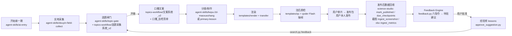

# 视频工作流（video-workflows）

秘书丞（赵伟健）的 AI 科普视频全流程：选题、文案、分镜、制作、质检、发布包，以及发布后的数据回收和反馈复盘。
这里只放**规则、脚本和模板**。数据库、截图、原始导出、成片和素材都不入库（见 `.gitignore`）。密钥只放在环境变量里。

## 流程图


## 各部分位置
| 目录 | 内容 | 盒上运行位置 |
|---|---|---|
| `agent-skills/ai-entry/` | 总入口 skill「AI科普视频全流程制作」，负责阶段路由、两档流程和状态 | `/home/box/agent-data/workflows/ai/` |
| `agent-skills/douyin-field-collect/` | 免登录抖音实地采集：SKILL.md、scripts/、requirements.txt | skill：`/home/box/agent-data/workflows/douyin-field-collect/`；脚本：`/workspace/skill_pkg/douyin-field-collect/`；venv：`/workspace/.venv-dy` |
| `agent-skills/kepu-2d-maoxuezhang/` | 科普短视频制作（猫学长 2D 风格、Remotion） | `/home/box/agent-data/workflows/skill-1792258650910/` |
| `agent-skills/primary-lesson/` | 小学讲题课程视频 | `/home/box/agent-data/workflows/skill-1792258664507/` |
| `agent-skills/topic-gate/` | 科技短视频前期调研与核查（选题闸门） | `/home/box/agent-data/workflows/skill-1792258671706/` |
| `topics-workflow/` | 选题采集系统 v2、文案系统 v2、口播自检清单、抖音实地硬规则、field 模板、前期 SOP | `/workspace/topics/workflow/` |
| `science-studio/` | 资产库和数据闭环：scripts/（含 Feedback Engine）、config/（workflow_spec、production_config）、docs/feedback_engine.md、adapters/（开放平台 stub）、reports/、projects/、reviews/ | `/workspace/science-studio/`（`db/studio.db` 不入库） |
| `templates/render/` | PC 渲染 ps1 模板（光遗传学全片 1080 实测 13 分钟），以及 README | 来源 `/workspace/optogenetics/pc_pack/` |
| `templates/transfer/` | 大文件分块传输：盒上 `split_for_pc.sh` 切块，PC 上 `merge_on_pc.ps1` 合并并校验 sha256；通用版 `make_pc_bundle.sh` + `assemble_from_home.ps1`（PC 上在 $HOME/下载/桌面自动找分块，按 sha256 校验，只新建不删除，2026-10-29） | — |
| `templates/qc/` | `qc_render.sh` 跑黑场、冻帧、响度、帧数和接缝峰值机检；`contact_sheet_stills.sh` 生成抽帧联系表；`structure_gate.py` + `prerender_checklist.md` 渲前结构闸门（2026-10-29） | — |
| `templates/review/`、`templates/state/` | 审片官一次交接单（时限 + 停止规则）；`stage_log.py` 给 STATE.md 记阶段用时（2026-10-29） | — |
| `templates/audio/`、`templates/vo/` | 混音（film_mix）、配音拼接（stitch_v2）、ASR 抽查脚本 | 来源 `/workspace/optogenetics/audio`、`/workspace/optogenetics/vo` |
| `workflows/footage-science-jellyfish/` | 实拍热点科普（火箭水母款）：网友/官方实拍逐镜署名 + 程序示意图 → Fish 整稿一条配音 → 抖音热歌 BGM（切点吸附强拍、−8 dB 闪避）→ 一句一字幕 → 盒上渲染 → 渲前结构闸门 → 自检 + 审片官 → 竖横两封面 + 「丞」朱印。标签 `footage-science-workflow-v1`；配套 `science-studio/tools/review/`（审片系统）、`templates/qc/structure_gate.py`、`templates/transfer/make_pc_bundle.sh`、`docs/效率审计_2026-10-29.md` | 来源 `/workspace/science-studio/projects/EP-20261029-01/` |
| `skills/`、`workflows/`、`projects/`、`docs/` | 2026-10-18/19 的旧版 skill、Roadster 和 iPhone 模板、示例工程、运营文档（保留，未改） | — |

模板里写死了光遗传学那期的 composition 名、zip 名和混音文件名。新一期复制后照 `science-studio/config/production_config.md` 的「PC 渲染步骤」改。

## 启动口令（对 Bot 说）
- 「开始新一期科普视频」走日常档，「开始新一期精品科普视频」走精品档，「继续上一期」接着上次做。
- 「已发布：<作品> <时间>」：调 `mark_published.py`，再按时点提醒回收数据。
- 发来创作者中心截图或 xlsx：跑 `ingest_screenshot.py extract → check → confirm`（xlsx 用 `ingest_metrics.py`）。
- 反馈六指令：「复盘最新视频」「检查最近作品表现」「最近观众有什么新需求」「找出近期最值得改进作品」「对比这期与历史同类」「根据历史反馈开始下一期选题」，对应 `python3 science-studio/scripts/feedback.py <指令>`。
- 「批准建议 #N」或「拒绝建议 #N」：调 `approve_suggestion.py`。只有用户本人说了才执行。

## 在新机器上恢复
1. `git clone https://github.com/zwjym1/video-workflows.git`
2. **skill**：把 `agent-skills/<x>/SKILL.md` 装回 Bot 的 workflows，对应关系见上表。采集脚本放到 `/workspace/skill_pkg/douyin-field-collect/`，然后执行 `python3 -m venv /workspace/.venv-dy && /workspace/.venv-dy/bin/pip install -r requirements.txt`。
3. **工作台**：把 `science-studio/` 复制到 `/workspace/science-studio/`，`topics-workflow/` 复制到 `/workspace/topics/workflow/`。
4. **数据库**：从 Google Drive「08_索引与数据库备份」取最新的 `studio_*.db`，放到 `science-studio/db/studio.db`。跑 `python3 scripts/search.py stats`，会自动迁移到 schema v3 并核对行数。没有备份时，空库也能自动建表。详见 `science-studio/docs/feedback_engine.md` §8。
5. **环境变量**（只用占位符，见 `.env.example`）：`FISH_API_KEY` 等密钥放在 `.env` 或系统环境里，不入库。抖音不登录。开放平台没有授权，adapter 只是 stub。
6. **版本回退**：见 `VERSIONS.md`。只做普通提交，不 force push。

## 边界
- 不绕过平台登录或安全验证；不让用户发密码或 Cookie。
- 不经用户批准不发布作品、不修改公开视频。
- 不付费、不改外部账号设置。

---
## 附：旧版说明（2026-10-18）

赵伟健的 AI 视频制作工作流，以及示例项目。

## 路线
1. **科普短视频**（`skills/kepu-short-video/`）：浙大学长风格的竖屏科普短视频，选题 → 钩子 → 文案 → 分镜 → 配音 → 渲染。
2. **小学讲题课程视频**（`skills/primary-lesson-video/`）：给小学生讲知识点的横屏课程视频，强调童趣画风、准确读音和逐句核对。
3. **科技短视频前期调研与核查**（`skills/tech-preproduction/`）：写稿前的热度扫描、竞品爆款、事实表、素材溯源、红线审查和开做/不做闸门。完整参考、博主来源和模板见 [docs/PREPRODUCTION-WORKFLOW.md](docs/PREPRODUCTION-WORKFLOW.md)。

科普短视频和小学讲题两套技能规则互相独立。秘书丞的 trending-news 中视频（16:9，1 分钟以上）在写稿前也走这道前期闸门。

自动化机器上不登录抖音。热度用 DataXAPI 公开榜单页、B 站，以及用户自己截的热点宝页面。

## 目录结构
```
skills/
  kepu-short-video/SKILL.md        科普短视频技能
  primary-lesson-video/SKILL.md    小学讲题课程视频技能
  tech-preproduction/SKILL.md      科技短视频前期调研与核查
projects/
  pi-lesson/                       示例：圆周率 π 小学课程视频
    step3-script-final.md          定稿文案
    step4-storyboard.md            分镜与视觉方案
    assets/SOURCES.md              素材来源
    style-frames/                  效果图及生成脚本 make.py
    remotion/                      Remotion 源码（WINDOWS-RENDER.md 为渲染指南）
    voice/                         配音记录和脚本
  gradient-descent/                科普示例：梯度下降 v4 源码和配音脚本
  tesla-roadster/                  B 站科普：特斯拉 Roadster（Remotion v3、对齐/混音工具、渲染参数）
docs/PREPRODUCTION-WORKFLOW.md     前期制作工作流（选题、核实、素材；含来源与模板）
docs/DOUYIN-OPS/                   抖音运营系统和发布/复盘清单
docs/VOICE-CONFIG.md               配音（Fish TTS）音色 ID 和配置教程
VERSIONS.md                        版本标签和回退方法
.env.example                       环境变量模板（只有占位符）
```

成片视频和大体积素材未入库；密钥只放环境变量，不入库。
